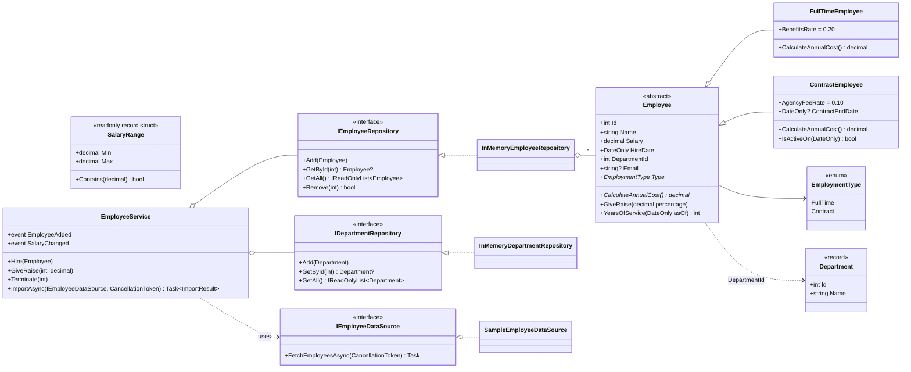

# Day 2: Domain design and SOLID

## Class diagram

GitHub and VS Code (with a Mermaid extension) render this diagram.

## Key design choices

| Choice | Reason |
|---|---|
| `Employee` is an **abstract class**, not an interface | The subclasses share real state and behaviour (validation, `GiveRaise`, `YearsOfService`). Only `CalculateAnnualCost` differs. An abstract class shares code; an interface only shares a contract |
| Repositories are **interfaces** | Unrelated implementations (in-memory now, EF Core in Week 2/3) share no code, only a contract |
| `Department` is a `record` | Immutable reference data with value equality |
| `SalaryRange` is a `readonly record struct` | Tiny immutable value. Avoids a heap allocation per filter |
| `Salary` has a **private setter** | It can only change through `GiveRaise`, which enforces the rules (encapsulation) |
| `EmployeeService` **has** repositories (composition) instead of **being** a repository (inheritance) | Collaborators can be swapped (fakes in tests, a database later). Inheritance would lock the service to one storage type |

## SOLID in this code

**S: Single Responsibility.** Each class has one reason to change:
- `Employee`: employee rules (valid salary, raises).
- `InMemoryEmployeeRepository`: storage only.
- `EmployeeQueries`: read-only queries.
- `EmployeeFormatter`: presentation text.
- `ConsoleUi`: user input and output.

Changing the report layout touches only `EmployeeFormatter`.

**O: Open/Closed.** Adding an `InternEmployee` type means writing a new subclass that overrides
`CalculateAnnualCost`. `TotalAnnualCost()` and the reports keep working without being edited, because
they call the virtual method.

**L: Liskov Substitution.** Any `Employee` subclass can be used wherever `Employee` is expected.
`TotalAnnualCost` sums `CalculateAnnualCost()` without checking the concrete type, and every subclass
keeps the base class rules (positive salary, valid name).

**I: Interface Segregation.** Employees and departments have separate, small interfaces
(`IEmployeeRepository`, `IDepartmentRepository`). Async fetching is its own `IEmployeeDataSource`, so a
repository isn't forced to implement network loading.

**D: Dependency Inversion.** `EmployeeService` depends on the interfaces and receives them through its
constructor. `Program.cs` is the only place concrete classes are created (the composition root). Tests
build the service with their own instances.
