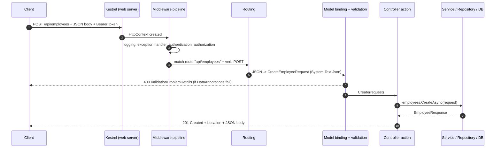

# Day 6: REST API basics

## What happens when a request reaches the API



1. **Kestrel** receives the bytes and builds an `HttpContext`.
2. The **middleware pipeline** runs in order (see [Day 7](day07-di-middleware.md)).
3. **Routing** picks the action from the URL and HTTP verb.
4. **Model binding** builds the DTO from the route, query string and JSON body. `[ApiController]` then
   runs validation and returns **400** automatically if the DTO is invalid.
5. The **action** calls a service, and the service calls the repository, which calls EF Core and SQLite.
6. The result is serialized to JSON (enums as strings, dates as `yyyy-MM-dd`) and travels back out
   through the middleware.

## Endpoints

| Verb | Route | Who | Success | Failure codes |
|---|---|---|---|---|
| POST | `/api/auth/login` | anyone | 200 token | 400, 401 |
| GET | `/api/auth/me` | signed in | 200 | 401 |
| GET | `/api/employees?departmentId&type&minSalary&maxSalary&search&sortBy&sortDirection&page&pageSize` | signed in | 200 page | 400, 401 |
| GET | `/api/employees/{id}` | signed in | 200 | 401, 404 |
| POST | `/api/employees` | HR, Admin | **201** + `Location` | 400, 401, 403, 409 |
| PUT | `/api/employees/{id}` | HR, Admin | **204** | 400, 401, 403, 404, 409 |
| PATCH | `/api/employees/{id}` | HR, Admin | 200 updated | 400, 401, 403, 404, 409 |
| DELETE | `/api/employees/{id}` | Admin | **204** | 401, 403, 404 |
| POST | `/api/employees/{id}/raise` | HR (≤ 20%), Admin | 200 | 400, 401, 403, 404 |
| GET | `/api/departments` | anyone | 200 | — |
| GET | `/api/departments/{id}` | anyone | 200 | 404 |
| GET | `/api/departments/summary` | signed in | 200 | 401 |
| POST | `/api/departments` | Admin | **201** | 400, 401, 403, 409 |
| DELETE | `/api/departments/{id}` | Admin | **204** | 401, 403, 404, 409 |
| GET | `/health` | anyone | 200 | — |

### REST conventions used

- **Nouns, not verbs**, in plural: `/api/employees`, `/api/employees/7`. The HTTP verb says what to do.
- The raise is an **action on a resource** (`POST /api/employees/7/raise`). It isn't a plain field edit,
  because it has its own rules (percentage limits by role).
- Filtering, sorting and paging go in the **query string**. They don't change the resource, just the view of it.
- `{id:int}` is a **route constraint**, so `/api/employees/abc` gives 404 instead of reaching the action.

## Status codes

| Code | Meaning | When this API returns it |
|---|---|---|
| **200 OK** | Success with a body | GET, PATCH, raise, login |
| **201 Created** | A new resource was created | POST employee or department. The `Location` header has the new URL |
| **204 No Content** | Success, nothing to return | PUT and DELETE |
| **400 Bad Request** | The client sent something invalid | DTO validation, malformed JSON, unknown department, bad query string |
| **401 Unauthorized** | Not authenticated: who are you? | No token, or a bad, tampered or expired token. Also a wrong password at login |
| **403 Forbidden** | Authenticated, but not allowed | Viewer creates, HR deletes, HR raise > 20% |
| **404 Not Found** | The resource doesn't exist | Unknown employee or department id |
| **409 Conflict** | Valid request that clashes with current state | Duplicate email or department name; deleting a department that has employees |
| **500** | Bug or outage | Unexpected exception. The client gets a generic message plus a `correlationId`; details go only to the log |

Every error uses the same **ProblemDetails** JSON (RFC 9457) with a `traceId` and `correlationId`:

```json
{
  "type": "https://tools.ietf.org/html/rfc9110#section-15.5.5",
  "title": "Resource not found",
  "status": 404,
  "detail": "Employee with id 9999 was not found.",
  "instance": "GET /api/employees/9999",
  "traceId": "00-7eec94eb...-00",
  "correlationId": "demo-req-404"
}
```

## PUT vs PATCH

| | PUT `/api/employees/{id}` | PATCH `/api/employees/{id}` |
|---|---|---|
| Meaning | **Replace** all editable fields | **Change only** the fields sent |
| Missing field | Set to empty (`email` omitted → email removed) | Left unchanged |
| Body | `UpdateEmployeeRequest`: name, salary and departmentId required | `PatchEmployeeRequest`: all optional, at least one required |
| Response | 204 No Content | 200 with the updated employee |
| Idempotent? | Yes: sending it twice gives the same result | This implementation is too (it sets values); PATCH in general isn't guaranteed to be |

Type, hire date and contract end date can only be set when the employee is created. Neither PUT nor
PATCH changes them.

## DTOs and JSON

- Requests and responses are DTOs (`Application/Dtos`), never the EF entities. Clients can't post an
  `id` or `annualCost`, and the JSON shape stays stable when the entities change.
- `JsonStringEnumConverter`: `"type": "FullTime"` instead of `0`.
- `DateOnly` is serialized as `"2026-11-01"`.

## Evidence

| What | Where |
|---|---|
| Runnable Web API | `src/EmployeeManagement.Api` (`dotnet run --project src/EmployeeManagement.Api`) |
| OpenAPI page | <http://localhost:5200/swagger> (Development) |
| Saved OpenAPI spec | [evidence/openapi-v1.json](../evidence/openapi-v1.json). Every operation lists its status codes, including 401/403 |
| `.http` file, success and failure requests | [src/EmployeeManagement.Api/EmployeeManagement.Api.http](../../src/EmployeeManagement.Api/EmployeeManagement.Api.http) |
| Captured responses (curl) | [evidence/week2-api-demo.log](../evidence/week2-api-demo.log) |
| Tests | `tests/EmployeeManagement.Api.Tests/Integration/EmployeesEndpointTests.cs` (201/204/400/404/409 over real HTTP) |
