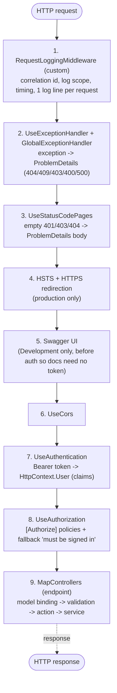

# Day 7: Dependency injection and middleware

## Request pipeline

Source: [Program.cs](../../src/EmployeeManagement.Api/Program.cs). A request goes **down** this list,
and the response comes back **up**.



### Why the order matters

| Order | Reason |
|---|---|
| Logging **first** | It wraps everything, so it records the **final** status code, including a 500 written by the exception handler below it. It also sets the correlation id that error responses include. |
| Exception handler **before** everything that can throw | Middleware only catches exceptions from components **after** it in the pipeline. |
| Swagger UI **before** authentication | Otherwise the fallback policy would require a token just to read the docs. |
| CORS **before** auth | Browser pre-flight `OPTIONS` requests carry no token and must be answered. |
| Authentication **before** authorization | Authorization needs to know *who* the user is (`HttpContext.User`) before deciding *what* they may do. Swap them and every protected endpoint returns 401. |
| Endpoints **last** | They are the end of the pipeline. Nothing after them runs for the request. |

## Custom middleware: `RequestLoggingMiddleware`

[Middleware/RequestLoggingMiddleware.cs](../../src/EmployeeManagement.Api/Middleware/RequestLoggingMiddleware.cs)

- Reads `X-Correlation-Id` from the request, or creates a new one. It echoes the id in the response
  header and stores it so ProblemDetails can include it.
- Opens a **log scope**, so every log line during the request (services, EF Core SQL) carries `CorrelationId`.
- Logs **one line per request**: `HTTP {Method} {Path} responded {StatusCode} in {ElapsedMs} ms`
  - Information for 2xx/3xx, Warning for 4xx, Error for 5xx.
- **Logs safely:**
  - No bodies, so no passwords.
  - No headers, so the `Authorization` token is never logged.
  - No query string, which can contain search terms or personal data.
  - An incoming correlation id is only accepted if it is at most 64 safe characters, so a client can't
    inject fake lines into the logs.
- Tests: [PipelineComponentTests.cs](../../tests/EmployeeManagement.Api.Tests/Unit/PipelineComponentTests.cs)
  check log levels and that no token or query string is logged. They also check id generation and
  reuse, rejection of unsafe ids, and that an exception thrown further down is logged as 500 and rethrown.

Sample output (from [evidence/week2-server-log.txt](../evidence/week2-server-log.txt)):

```
11.54.17 warn: EmployeeManagement.Api.Middleware.RequestLoggingMiddleware[0]=> CorrelationId:c607bb3900af44fb97c46ef0c36715ab HTTP POST /api/employees responded 403 in 6.3 ms
```

## Service lifetimes

| Lifetime | Meaning | Registered here | Why |
|---|---|---|---|
| **Singleton** | One instance for the whole app | `TimeProvider.System`, `ITokenService` (JwtTokenService), `IOptions<JwtOptions>` | Stateless and thread-safe. Creating them once is cheapest. |
| **Scoped** | One instance per HTTP request | `AppDbContext`, `IUnitOfWork`, all repositories, `IEmployeeService`, `IDepartmentService`, `IAuthService`, `ICurrentUser`, `DatabaseInitializer` | The DbContext tracks the entities of *one* request and isn't thread-safe. Everything that uses it must live no longer than it. |
| **Transient** | A new instance every time it's requested | `IPasswordHasher` (PasswordHasherAdapter) | Stateless and cheap. Nothing to share. |

Registrations are grouped by layer: `AddApplication()`, `AddInfrastructure()`, `AddApiSecurity()`.

### Captive dependency

A **captive dependency** happens when a longer-lived service holds a shorter-lived one. For example, a
singleton `JwtTokenService` that took `AppDbContext` in its constructor would keep the first request's
DbContext forever. That DbContext would be shared across threads, with stale data and a growing change tracker.

How this project avoids it:
- Singletons only depend on singletons (`IOptions<T>`, `TimeProvider`).
- `ValidateScopes = true` and `ValidateOnBuild = true` are set in `Program.cs`, so a captive dependency
  or missing registration fails **at startup**, not at the first request.

### Why DI?

- **Loose coupling.** `EmployeeService` asks for `IEmployeeRepository` and never calls `new`. In Week 1
  the console app used an in-memory store; now the API uses EF Core. The service code didn't change.
- **Testability.** Unit tests construct services with fakes, e.g. `EmployeeServiceTests` passes
  `FakeEmployeeRepository` and `FakeCurrentUser("HR")`.
- **Lifetime management.** The container creates and disposes objects at the right time (DbContext per request).

## Configuration per environment

| Source (later wins) | Contains |
|---|---|
| `appsettings.json` | Defaults for all environments. JSON console logs; migrations and seeding **off**; empty `Jwt:SigningKey` |
| `appsettings.Development.json` | Readable single-line logs with scopes; EF SQL logging on; migrate and seed **on**; CORS for `localhost:3000` |
| **User secrets** (Development only) | `Jwt:SigningKey`, `Database:DemoUserPassword`. Stored outside the repo |
| Environment variables | Production secrets, e.g. `Jwt__SigningKey` |
| Test settings (`ApiFactory`) | In-memory database and a test-only signing key |

**Options pattern:** `JwtOptions` is bound from the `Jwt` section and validated with DataAnnotations plus
`ValidateOnStart()`. If the key is missing or shorter than 32 characters, the app refuses to start and
explains how to set it.

## Logging with `ILogger`

- **Structured logging:** message templates with named placeholders, e.g.
  `logger.LogInformation("Employee {EmployeeId} created in department {DepartmentId} by {UserName}", ...)`.
  The JSON formatter (production) writes `EmployeeId`, `DepartmentId` and so on as separate fields that
  log tools can filter on. Don't use string interpolation (`$"..."`) here, because it loses the fields.
- **Scopes:** the middleware's `BeginScope("CorrelationId:{CorrelationId}", id)` attaches the id to every line.
- **Levels by environment:** EF Core SQL is visible in Development and hidden (Warning) in production.
