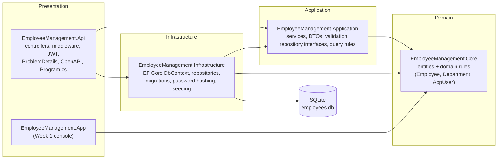

# Day 8: Layered architecture and validation

## Projects and dependencies



**The rule: dependencies point inwards.**
- `Core` depends on nothing.
- `Application` depends only on `Core`. It *defines* `IEmployeeRepository`.
- `Infrastructure` *implements* those interfaces with EF Core.
- The API references Infrastructure **only** in `Program.cs`, to register services.
- Controllers talk to `IEmployeeService` and never to the DbContext.

You can check this in the `.csproj` files: `Application` has no EF Core or ASP.NET Core package, so it
*can't* use `DbContext` or `HttpContext` by accident.

## Responsibilities

| Layer | Does | Does not |
|---|---|---|
| **Controller** (`Api/Controllers`) | Routing, model binding, picking the status code (201 vs 204), `[Authorize]` | Business rules, SQL, try/catch for errors |
| **Service** (`Application/Services`) | Business rules: department must exist, unique email, HR raise limit. Orchestrates repositories and saves through the unit of work. Logs business events | HTTP (no status codes), EF Core |
| **Repository** (`Infrastructure/Persistence`) | Data access: queries, `Include`, `AsNoTracking`, paging in SQL | Business decisions |
| **Domain entity** (`Core/Models`) | Its own invariants: salary > 0, valid name, raise ≤ 100% | Persistence, HTTP |

**Repository vs service:**
- A repository answers "how do I load and save employees?"
- A service answers "what is allowed to happen?", e.g. "HR may approve 20%, Admin 100%".
- One service method can use several repositories and commit them together with `IUnitOfWork.SaveChangesAsync()`.

## DTO vs entity

| | Entity (`Core/Models/Employee`) | DTO (`Application/Dtos`) |
|---|---|---|
| Purpose | Business object with behaviour (`GiveRaise`, `CalculateAnnualCost`) | Shape of the JSON contract |
| Stored by EF? | Yes | No |
| Example fields | Private-set `Salary`, `Department` navigation | `CreateEmployeeRequest` (no Id); `EmployeeResponse` (adds `DepartmentName`, `AnnualCost`, `SalaryBand`) |

Why keep them separate:
- **Over-posting protection.** The client can't set `Id`.
- **Stable API.** Renaming a column doesn't break clients.
- **No accidental exposure.** `AppUser.PasswordHash` is never serialized.
- **No serialization loops** through navigation properties.

**Mapping is manual** ([EmployeeMappings.cs](../../src/EmployeeManagement.Application/Mapping/EmployeeMappings.cs)).
For a handful of DTOs it's explicit, checked by the compiler and easy to debug. AutoMapper is
convention-based reflection: less code to write for big models, but mapping mistakes show up only at runtime.

## Validation in three places

| Where | What | Example | Result |
|---|---|---|---|
| 1. DTO (DataAnnotations + `IValidatableObject`) | Shape of the request | Name length 2–100; email format; salary 0.01–10,000,000; contract end date only for contracts and after the hire date; pageSize 1–100; `sortBy` must be in the allowed list | **400** `ValidationProblemDetails`, sent automatically by `[ApiController]` before the action runs |
| 2. Service | Rules that need data | Department exists; email not used by another employee; HR raise ≤ 20% | `BusinessRuleException` → 400; `ConflictException` → 409; `ForbiddenException` → 403 |
| 3. Domain entity | Invariants that must *never* break | `Salary` > 0 and ≤ max; `GiveRaise` % in (0, 100] | `ArgumentException` → 400 (defence in depth) |

Every layer reports errors in the **same JSON shape**: field name → messages.

```json
{
  "title": "One or more validation errors occurred.",
  "status": 400,
  "errors": {
    "Name": ["The Name field is required."],
    "Email": ["The Email field is not a valid e-mail address."],
    "Salary": ["The field Salary must be between 0.01 and 10000000."],
    "DepartmentId": ["The field DepartmentId must be between 1 and 2147483647."]
  },
  "traceId": "00-...", "correlationId": "..."
}
```

```json
{ "title": "One or more validation errors occurred.", "status": 400,
  "errors": { "DepartmentId": ["Department 99 does not exist."] } }
```

```json
{ "title": "Conflict", "status": 409,
  "detail": "Another employee already uses the email 'asha.menon@example.com'." }
```

Full captured responses: [evidence/week2-api-demo.log](../evidence/week2-api-demo.log).

## Central exception handling

[GlobalExceptionHandler.cs](../../src/EmployeeManagement.Api/ErrorHandling/GlobalExceptionHandler.cs)
implements `IExceptionHandler`:

| Exception | Status | Logged as |
|---|---|---|
| `NotFoundException` | 404 | Warning, no stack trace |
| `ConflictException` | 409 | Warning |
| `ForbiddenException` | 403 | Warning |
| `BusinessRuleException` | 400 with field errors | Warning |
| `ArgumentException` (domain) | 400 with field errors | Warning |
| anything else | 500 with a generic message, **no internal details** | **Error with stack trace** |

**Exceptions vs a Result pattern:** this project uses exceptions for "not found / conflict / forbidden",
which keeps services short. The cost is that the possible failures aren't visible in method signatures.
A `Result<T>` type makes them explicit, but every caller has to check it. Both are valid; consistency matters most.

**Middleware vs filter:**
- **Middleware** runs for *every* request and knows nothing about MVC. That's why logging, CORS, auth
  and the exception handler are middleware.
- An **action filter** runs only around MVC actions and can see MVC details: the chosen action, bound
  arguments and `ModelState`. `[ApiController]`'s automatic 400 is a filter.
- Rule of thumb: cross-cutting HTTP concerns go in middleware; behaviour tied to controllers or models
  goes in a filter.

## Tests for this day

- [RequestValidationTests.cs](../../tests/EmployeeManagement.Api.Tests/Unit/RequestValidationTests.cs):
  every DTO rule, with boundaries and invalid input.
- [EmployeeServiceTests.cs](../../tests/EmployeeManagement.Api.Tests/Unit/EmployeeServiceTests.cs):
  business rules with fake repositories (unknown department, duplicate email, PUT vs PATCH semantics,
  raise limits, nothing saved on failure).
- [PipelineComponentTests.cs](../../tests/EmployeeManagement.Api.Tests/Unit/PipelineComponentTests.cs):
  exception → status code mapping, including that a 500 doesn't leak details.
