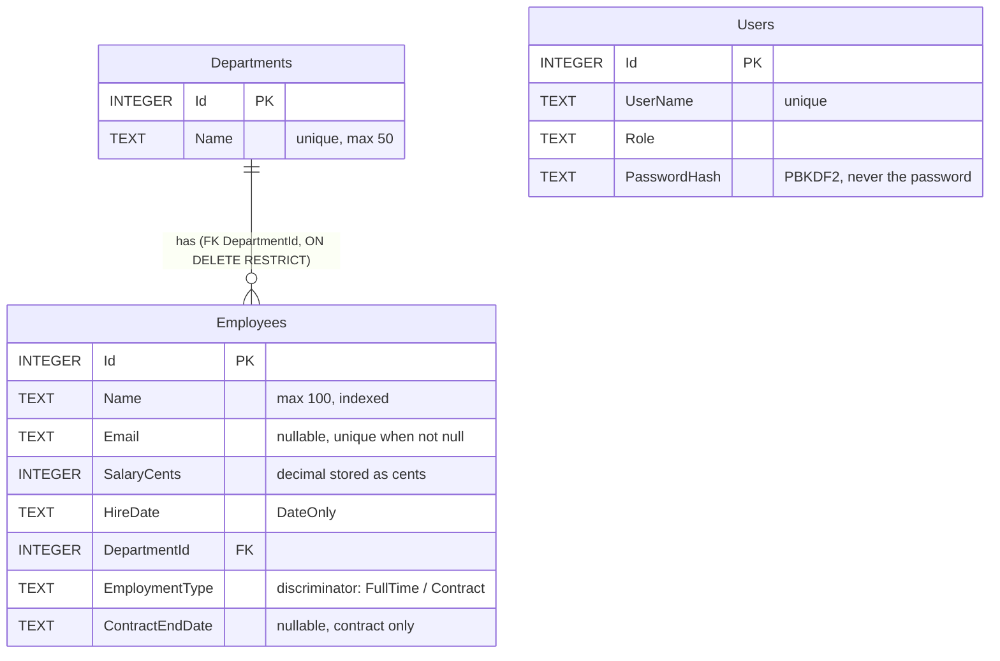

# Day 9: EF Core and the database

**Database:** SQLite, a file-based relational database (`src/EmployeeManagement.Api/employees.db`).
- Nothing to install, so a reviewer can clone the repo and run it straight away.
- Moving to SQL Server means changing `UseSqlite` to `UseSqlServer` and the connection string, then
  re-generating migrations. See *Limitations* below.

## Model



All configuration is **Fluent API**, in
[Persistence/Configurations](../../src/EmployeeManagement.Infrastructure/Persistence/Configurations). The
Week 1 domain classes have no EF attributes.

| Feature | How |
|---|---|
| **Relationship** | `HasOne(e => e.Department).WithMany().HasForeignKey(e => e.DepartmentId).OnDelete(Restrict)`. Many employees belong to one department. *Restrict* means the database refuses to delete a department that still has employees (the API returns 409 before that happens). |
| **Inheritance** | **Table-per-hierarchy**: `FullTimeEmployee` and `ContractEmployee` share one table, and the `EmploymentType` column tells EF which class to create. |
| **Value conversion** | SQLite has no decimal type, and EF can't compare or `ORDER BY` decimals stored as text. `Salary` is stored as `long` cents (`SalaryCents`), so filtering and sorting by salary run in SQL, exactly. |
| **Encapsulated entities** | EF uses the constructors and writes private backing fields (`_salary`, `_name`), so `Salary` stays `private set` and the domain rules hold. |
| **Indexes** | Unique `Department.Name` and `Users.UserName`. Unique filtered `Employees.Email` (`WHERE Email IS NOT NULL`). Plus `DepartmentId` and `Name` for filtering and sorting. |

## Migrations and setup

```bash
dotnet tool restore                      # installs dotnet-ef 10.0.15 from dotnet-tools.json

# Create / update the database explicitly (what you'd do in production):
dotnet ef database update -p src/EmployeeManagement.Infrastructure -s src/EmployeeManagement.Api

# After changing the model, add a migration:
dotnet ef migrations add <Name> -p src/EmployeeManagement.Infrastructure -s src/EmployeeManagement.Api -o Persistence/Migrations
```

- In **Development**, the app also applies migrations and seeds the Week 1 sample data at startup
  (`Database:MigrateOnStartup` / `SeedDemoData`). In production both are `false`, and migrations are a
  deployment step.
- The migration is
  [20261124114425_InitialCreate.cs](../../src/EmployeeManagement.Infrastructure/Persistence/Migrations/20261124114425_InitialCreate.cs).
- `DesignTimeDbContextFactory` lets `dotnet ef` build the DbContext without starting the web app,
  which would need the JWT secret.
- To start again from an empty database, stop the API and delete `src/EmployeeManagement.Api/employees.db*`.

## Filtering, sorting, paging

`GET /api/employees?departmentId=1&type=FullTime&minSalary=50000&maxSalary=100000&search=kumar&sortBy=salary&sortDirection=desc&page=2&pageSize=5`

The rules live in [EmployeeQueryExtensions.cs](../../src/EmployeeManagement.Application/Queries/EmployeeQueryExtensions.cs)
as `IQueryable<Employee>` methods:
- `ApplyFilters` (all filters are combined with AND)
- `ApplySorting` (always ends with `ThenBy(Id)`, so page boundaries are stable)
- `ApplyPaging`

- **In the API**, EF Core turns them into SQL, so only one page of rows leaves the database.
- **In unit tests**, the same methods run on a `List` via `AsQueryable()`
  ([EmployeeQueryExtensionsTests.cs](../../tests/EmployeeManagement.Api.Tests/Unit/EmployeeQueryExtensionsTests.cs)),
  so the rules are tested without a database.
- **Safe queries:**
  - User input is only ever a **parameter** (`@departmentId`, `@email`), never concatenated into SQL.
  - `sortBy` is checked against an allow-list (`id, name, salary, hireDate`), so it can't inject a column name.
  - `pageSize` is capped at 100.

## Generated SQL

Captured from the Development log ([evidence/week2-ef-sql.log](../evidence/week2-ef-sql.log)):

**Page of employees** (`?departmentId=1&sortBy=salary&sortDirection=desc&page=1&pageSize=2`): two queries, a `COUNT` and the page:

```sql
SELECT COUNT(*) FROM "Employees" AS "e" WHERE "e"."DepartmentId" = @departmentId

SELECT "e0"."Id", "e0"."DepartmentId", "e0"."Email", "e0"."EmploymentType", "e0"."HireDate",
       "e0"."Name", "e0"."SalaryCents", "e0"."ContractEndDate", "d"."Id", "d"."Name"
FROM (
    SELECT ... FROM "Employees" AS "e"
    WHERE "e"."DepartmentId" = @departmentId
    ORDER BY "e"."SalaryCents" DESC, "e"."Id" DESC
    LIMIT @p2 OFFSET @p
) AS "e0"
INNER JOIN "Departments" AS "d" ON "e0"."DepartmentId" = "d"."Id"
ORDER BY "e0"."SalaryCents" DESC, "e0"."Id" DESC
```

- The `WHERE`, `ORDER BY` and `LIMIT/OFFSET` all run in the database.
- `.Include(e => e.Department)` became **one JOIN**, done *after* paging so only the page's rows are joined.

**Department list with headcount:** one query with a correlated `COUNT` subquery:

```sql
SELECT "d"."Id", "d"."Name", (SELECT COUNT(*) FROM "Employees" AS "e" WHERE "e"."DepartmentId" = "d"."Id")
FROM "Departments" AS "d" ORDER BY "d"."Name"
```

**PATCH that changed only the email:** change tracking writes only the modified column:

```sql
UPDATE "Employees" SET "Email" = @p0 WHERE "Id" = @p1 RETURNING 1;
```

Parameter values appear as `'?'` because `EnableSensitiveDataLogging` is off, so salaries and emails
never reach the log.

## Tracking vs no-tracking

| | Tracking (default) | `AsNoTracking()` |
|---|---|---|
| What EF does | Keeps a snapshot of each loaded entity in the change tracker | Just materializes objects |
| `SaveChanges` | Detects changes and generates `UPDATE ... SET <changed columns>` | Sees nothing to save |
| Cost | More memory and CPU per row | Faster, lighter |
| Used in this project | `EmployeeRepository.GetByIdAsync`, because the service changes the entity and saves | `SearchAsync`, `GetAllAsync`, `ListWithHeadcountAsync`, `GetByUserNameAsync`: read-only |

## Loading related data, and the N+1 problem

| Strategy | How | Here? |
|---|---|---|
| **Eager** | `.Include(e => e.Department)`: one JOIN | Yes: employee list and details |
| **Projection** | `.Select(d => new DepartmentResponse(..., db.Employees.Count(...)))`: only the needed columns, computed in SQL | Yes: department list |
| **Explicit** | `db.Entry(e).Reference(x => x.Department).LoadAsync()`: a separate query when you decide | Not needed |
| **Lazy** | A proxy loads the navigation on first access (needs the `Proxies` package and virtual properties) | **Deliberately not used**: it hides queries and causes N+1 |

**N+1:** load N employees (1 query), then touch `employee.Department.Name` in a loop. With lazy loading,
each access runs another query: 1 + N queries. For 10,000 employees that's 10,001 round trips. The fix
is `Include` or a projection, giving 1 query (or 2 with the page count), as shown above.

## Transactions

- `SaveChangesAsync()` wraps **all** pending inserts, updates and deletes in **one transaction**. Either
  everything is saved or nothing is.
- A service method changes entities through the repositories and then calls
  `IUnitOfWork.SaveChangesAsync()` **once**.
- If a business rule fails first, nothing is saved. Tests assert `SaveCount == 0` on failure.
- For work across several `SaveChanges` calls, use an explicit transaction:
  `await using var tx = await db.Database.BeginTransactionAsync(); ...; await tx.CommitAsync();`.
  Not needed in this API yet.

## DbContext lifetime

**Scoped**: one per HTTP request. A DbContext isn't thread-safe and its change tracker only grows, so it
must never be a singleton. See [Day 7](day07-di-middleware.md#captive-dependency).

## EF Core vs Dapper

| | EF Core | Dapper |
|---|---|---|
| You write | LINQ | SQL by hand |
| Gives you | Change tracking, migrations, relationships, `Include`, provider independence | Fast, thin mapping of query results to objects |
| Best for | CRUD-heavy domain apps (like this one) | Hot read paths, complex hand-tuned SQL, reports |

Many teams use both: EF Core for writes, and Dapper for a few heavy read queries.
